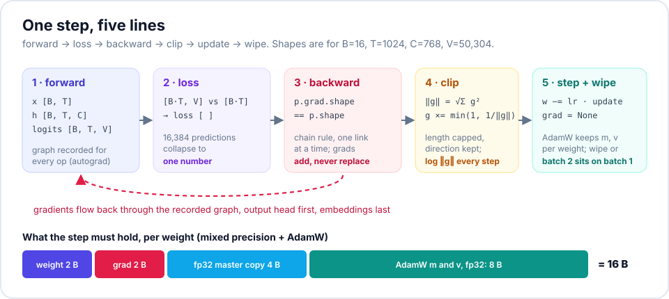
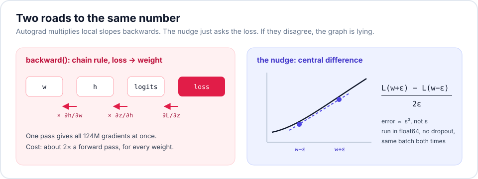
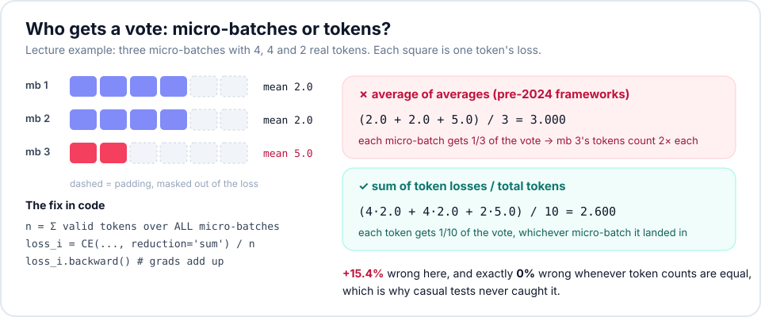
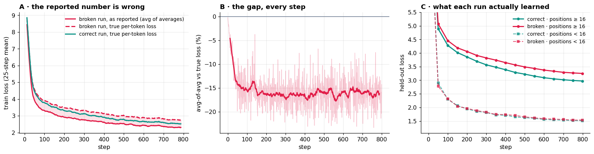
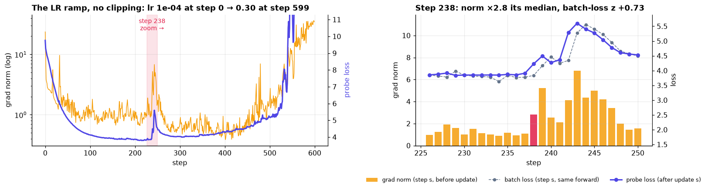
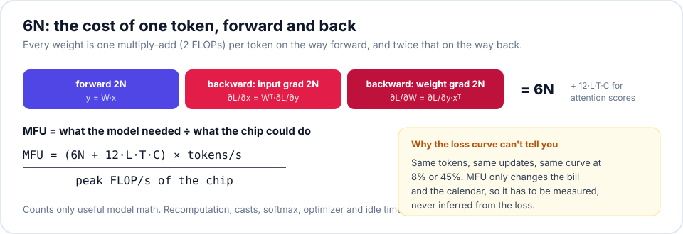
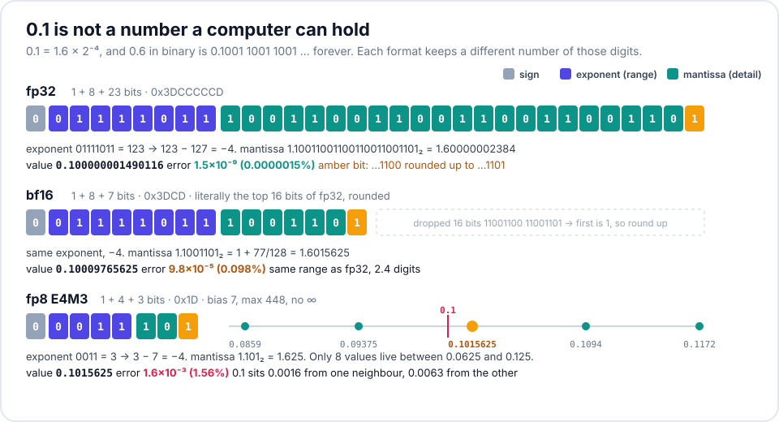

# The training loop, made to tell the truth

**ERA V5 · Session 10.** A real 30M-parameter GPT training loop on a Colab **Tesla T4**, made to account for itself:
tensor shapes, a gradient checked by hand, gradient accumulation broken on purpose, the grad norm as an early warning,
an honest MFU, and the number 0.1 in fp32 / bf16 / fp8.

| | |
|---|---|
| Notebook (executed, all outputs) | [`training_loop.ipynb`](training_loop.ipynb) |
| Same notebook as plain Python (jupytext) | [`training_loop.py`](training_loop.py) |
| Hardware | Colab, Tesla T4 16 GB, PyTorch 2.11, fp16 autocast + `GradScaler` |
| Model | nanoGPT-style decoder: 6 layers, 6 heads, C = 384, T = 256, GPT-2 tokenizer (V padded to 50,304), tied embeddings, **30,062,592 parameters** |
| Data | TinyStories (V2 valid split): 27,630 stories, 5.2M train / 0.27M val tokens. Story lengths vary (median 177 tokens), which §3 needs. |

Every number below is copied from the notebook's executed output. Nothing is estimated unless it is marked `[estimate]`.

## Results at a glance

| Task | Result |
|---|---|
| 1 · Shapes | 22 tensors from `idx` to `wte.grad`, each with one line saying what its dimensions mean. `logits.grad` equals `(softmax − onehot)/BT` to 2.5×10⁻¹⁴. |
| 2 · Gradient by hand | `backward()` and a central-difference nudge agree to **7×10⁻¹⁰ – 3×10⁻⁸** relative error on 5 weights in float64. fp32 manages at best 5×10⁻⁴, fp16 autocast 3×10⁻³. |
| 3 · Accumulation broken | Broken gradient is **48% off** the one-big-batch gradient (correct: 7.7×10⁻⁷). The dashboard reads **16% too low**, yet held-out loss is **3.249 vs 2.971**. |
| 4 · Grad norm first | **Step 390**: norm jumps 0.67 → 3.06 (5× trailing median) while that step's batch loss is ordinary (z = +0.6). The probe loss then rises 4.262 → 4.373 and stays there. |
| 5 · MFU | **12.8%** (8.31 TFLOP/s of 65). The T4's own best matmul reaches 33% of peak. Softmax/CE over V takes as much GPU time as all the matmuls. |
| 6 · 0.1 | fp32 `0x3DCCCCCD`, bf16 `0x3DCD`, E4M3 `0x1D`. **I'd train in bf16 mixed precision with fp32 master weights.** |

---

## 1 · Every tensor shape in the step

B = 16 sequences, T = 256 positions, C = 384 channels, 6 heads of 64, V = 50,304. The shapes are recorded with forward hooks
on a real batch, and gradient shapes are read after `backward()`.

| tensor | shape | what each dimension means |
|---|---|---|
| `idx` | (16, 256) | B, T: token ids, B sequences of T positions |
| `wte(idx)` | (16, 256, 384) | B, T, C: one C-wide vector per token |
| `wpe(arange(T))` | (256, 384) | T, C: one vector per position, broadcast over B |
| `x = tok + pos` | (16, 256, 384) | B, T, C: the residual stream |
| `qkv = c_attn(ln1(x))` | (16, 256, 1152) | B, T, 3C: q, k and v for every position, side by side |
| `q` (k, v identical) | (16, 6, 256, 64) | B, heads, T, head_dim: each head works on its own 64-wide slice of C |
| scores `q·kᵀ/√d` (virtual) | (16, 6, 256, 256) | B, heads, T_query, T_key: SDPA fuses this, never stored |
| `softmax(scores)·v` | (16, 6, 256, 64) | B, heads, T, head_dim: weighted mix of earlier v |
| heads merged | (16, 256, 384) | B, T, C: heads concatenated back into the channel axis |
| `x + attn_proj(y)` | (16, 256, 384) | B, T, C: residual stream after attention |
| `fc(ln2(x))` | (16, 256, 1536) | B, T, 4C: the MLP widens every position 4× |
| `x + mlp_proj(gelu(h))` | (16, 256, 384) | B, T, C: residual stream leaving the block |
| after all 6 blocks | (16, 256, 384) | B, T, C: blocks 1–5 repeat block 0 exactly |
| `ln_f(x)` | (16, 256, 384) | B, T, C: normalised before the head |
| `logits = head(x)` | (16, 256, 50304) | B, T, V: a score for every vocabulary entry at every position |
| `y` (targets) | (16, 256) | B, T: x shifted left by one, the token each position must predict |
| `logits.view(-1, V)` | (4096, 50304) | B·T, V: every position becomes one 50,304-way classification |
| `loss` | () | one scalar, the mean over all 4,096 predictions |
| `logits.grad` | (16, 256, 50304) | B, T, V: `(softmax − one_hot) / (B·T)`, the first thing `backward()` produces |
| `wte.weight.grad` | (50304, 384) | V, C: always the weight's own shape; tied, so it sums the head and embedding paths |
| `blocks[0].c_attn.weight.grad` | (1152, 384) | 3C, C: `nn.Linear` stores (out_features, in_features) |
| `blocks[0].fc.weight.grad` | (1536, 384) | 4C, C: the MLP up-projection |

Two checks on the first gradient: every row of `logits.grad` sums to ~0 (max |row sum| 2.1×10⁻¹⁰), and it equals
`(softmax − onehot)/BT` to 2.5×10⁻¹⁴. The parameter count is 19.3M for the tied embedding, 98k for positions,
1.77M per block, **30,062,592 total**. Untied, the head would add another 19.3M.

## 2 · One gradient, verified by hand

For a weight $w$, nudge it both ways and ask the loss: $\frac{\partial L}{\partial w} \approx \frac{L(w+\varepsilon) - L(w-\varepsilon)}{2\varepsilon}$.
I start with the lecture's toy chain (backward 64.00000000, nudge 64.00000001), then check the real model in **float64**
with ε = 10⁻⁶ on one same fixed batch, picking the largest-gradient weight in five different kinds of layer:

| weight | index | `backward()` | nudge | relative error |
|---|---|---|---|---|
| `blocks[0].fc.weight` | (399, 315) | −1.3185790894e-02 | −1.3185790948e-02 | 4.1e-09 |
| `blocks[5].attn_proj.weight` | (146, 126) | 5.3563493161e-02 | 5.3563493196e-02 | 6.6e-10 |
| `ln_f.weight` | (229,) | −6.8257657423e-03 | −6.8257657304e-03 | 1.7e-09 |
| `wpe.weight` (position 3) | (3, 7) | 1.1577505115e-02 | 1.1577505088e-02 | 2.4e-09 |
| `wte.weight` (token `' She'`, tied) | (1375, 11) | 2.5933229878e-03 | 2.5933230674e-03 | 3.1e-08 |

**8–10 significant digits on every weight.** The tied `wte` entry is the most interesting: its gradient is the sum of the
embedding path and the output-head path, and the nudge, which only asks the loss, agrees with that sum.

**Where it stops agreeing** ([plot](results/r1-nudge-precision.png)). I repeated the nudge in fp32 and in fp16 autocast over
ε from 10⁻⁸ to 1. The best you can get is **5×10⁻⁴ in fp32** (at ε = 3×10⁻²) and **2.6×10⁻³ under fp16 autocast** (at ε = 10⁻¹).
Small ε fails because a loss of ~11 is only stored to ~10⁻⁶ in fp32, so the nudge disappears into rounding. Large ε fails
from truncation error. That V shape is why gradient checks are always done in float64.

**Gradients add, they don't replace:** two `backward()` calls without `zero_grad()` give exactly 2.000000× the gradient.
That is the mechanism accumulation relies on, and the bug it causes when you forget to clear them.

## 3 · Gradient accumulation, broken on purpose

**Setup.** Each step uses 4 micro-batches of 8 whole stories, cut at **T = 16, 32, 128 and 256**, padded, with padding
ignored. That gives very different numbers of real tokens: **128, 256, 1,017 and 1,355**.

- **correct:** `loss_i.sum() / N_total` per micro-batch, so every real token in the step has equal weight.
- **broken:** `loss_i.mean() / 4`, the average of averages. A token in the T=16 micro-batch gets **5.4× the weight** of a
  token in the T=256 one.

On one fixed step, the correct version matches the one-big-batch gradient to **7.7×10⁻⁷**. The broken one is **48% off**
(cosine 0.92, 1.19× too long). Then I trained both for 800 steps, same seed and same data order:

| after 800 steps | correct | broken |
|---|---|---|
| true per-token train loss (mean of last 50 steps) | **2.527** | 2.752 (+0.225) |
| logged vs true per-token loss, last 100 steps | 0% | **−16.2%** (every step between −23.3% and −0.3%) |
| held-out loss, positions ≥ 16 | **2.971** | 3.249 (+0.278) |
| held-out loss, positions < 16 | 1.513 | 1.537 (+0.024) |

**What it shows.**
- **The sign surprised me.** The lecture's example overstated the loss by 15.4%. Here the broken dashboard **understates** it by 16%. The T=16 micro-batch
  holds only story openings ("Once upon a time…"), which are easy to predict, and the average of averages over-weights them.
  So the broken run *looks* better on its own chart (panel A) while being worse. Which way the error goes depends on which
  micro-batches are easy, so the curve can't tell you.
- **The damage is real.** On the long-context loss the broken run ends 0.28 nats behind, where the correct run already
  was at about step 475 of 800. On short positions, the ones it over-trained on, the two runs are level. Weighting by
  (Σw)²/Σw² leaves only ~1,190 effective tokens per step out of 2,756.
- **Fix:** count the real tokens across the whole step once, before the first `backward()`, and divide every micro-batch's
  summed loss by that one number.

## 4 · The grad norm, every step, and a step where it moved first

The main run is 2,000 steps, lr 1e-3 with cosine decay, clip at 1.0. It logs the total grad norm **before** clipping at every
step. After warmup the norm is tightly bounded: median 0.948, p95 1.036, p99 1.114, max 1.454. Clipping fires on 13% of
steps and only trims them ([plot](results/r3-main-run.png)).

A healthy run makes a poor example, so to find a step where the norm moves before the loss I ran an **LR ramp**
(1e-4 → 0.3 over 600 steps, **no clipping**). On every step it logs:
the grad norm, the batch loss from that *same* forward pass, and the loss on a **fixed probe batch** after the update. That
last one is a noise-free loss that can't be fooled by an easy or hard batch.

**Step 390** (lr ≈ 0.018) is the clearest case:

- The grad norm jumps **0.666 → 3.064**, 5.0× its trailing 20-step median.
- The batch loss from that same forward pass is **4.204**, an ordinary value (z = +0.62). The loss gives no warning.
- The update made from that gradient lifts the probe loss **4.262 → 4.373** (5.7× its step-to-step jitter), and it
  **stays up**: 4.371, 4.373, 4.361. The norm moved at step *s*. The loss showed it at *s + 1* and never recovered.

The wider view in the left panel tells the same story: the probe loss bottoms out at step 251. Between steps 300 and 450 the norm
*falls* (1.06 → 0.42) while the loss quietly climbs. From ~460 the norm rises steadily (0.46 → 2.3) and the run goes
non-finite at **step 538**. With clipping at 1.0, step 390's gradient would have been scaled to a third before it reached AdamW.

## 5 · MFU, measured honestly

$$\text{FLOPs/token} = 6N + 12\,L\,T\,C = 6(29{,}964{,}288) + 12(6)(256)(384) = 186.9\text{M}\quad(\text{attention adds }3.9\%)$$

| quantity | value |
|---|---|
| median step time (B = 16, T = 256, after warmup) | 92.1 ms |
| tokens / s | 44,470 |
| model FLOP/s achieved | 8.31 TFLOP/s |
| T4 peak, fp16 tensor cores (datasheet) | 65 TFLOP/s |
| **MFU** | **12.8%** |
| best fp16 matmul this T4 actually sustains (measured) | 21.2 TFLOP/s = 33% of peak |
| MFU relative to that measured ceiling | 39% |

Where the GPU time goes (`torch.profiler`, one step, by kernel):

| kernel group | ms / step | share |
|---|---|---|
| softmax / cross-entropy over V | 25.99 | 29.1% |
| matmuls on tensor cores | 25.73 | 28.8% |
| dtype casts & copies | 15.14 | 16.9% |
| other elementwise / reductions | 10.98 | 12.3% |
| optimizer (fused AdamW, unscale) | 6.24 | 7.0% |
| attention kernel (SDPA) | 3.26 | 3.6% |
| layernorm | 2.04 | 2.3% |

| variant | ms / step | tok / s | MFU |
|---|---|---|---|
| eager, B = 16 (the run above) | 91.6 | 44,704 | 12.9% |
| eager, B = 32 | 178.2 | 45,959 | 13.2% |
| `torch.compile`, B = 16 | 89.4 | 45,798 | 13.2% |
| `torch.compile`, B = 32 | 173.5 | 47,209 | 13.6% |

**What is costing me the distance to 40%, biggest first:**

1. **The chip can't reach its own datasheet.** The best fp16 matmul a Colab T4 sustains is 33% of 65 TFLOP/s: a 70 W card that
   lowers its clocks under load. So 40% against the datasheet is impossible here even with perfect code. Against what the card
   actually delivers, this loop is at 39%.
2. **The vocabulary eats the step.** The matmuls that MFU counts take only 29% of GPU time. Softmax and cross-entropy over
   50,304 classes take *another* 29%, because I upcast logits to fp32 for a stable loss: a 4,096 × 50,304 fp32 tensor is 824 MB,
   written and read several times. A further 17% is dtype casts, from that same `.float()` and from autocast re-casting the fp32
   weights to fp16 on every forward pass. In a 30M model where 19M weights are the embedding, this is the main cost, not a footnote.
3. **The model is too thin.** With C = 384, every matmul has a 384-wide inner dimension, so it does little arithmetic per byte
   moved. `torch.compile` (+2.5%) and doubling the batch (+3%) barely help, which shows the loss is in the work itself, not in
   launch overhead.
4. **fp16 bookkeeping.** The T4 has no bf16 tensor cores, so every step pays for loss scaling, unscaling and the inf check,
   on top of AdamW (7% together).

**To close the gap:** a fused or chunked cross-entropy that never materialises fp32 logits (`[estimate]` ~1.7× faster step,
≈ 22% MFU), a wider model (C ≥ 768) so matmuls dominate, and a bf16-native GPU (A100/H100).

## 6 · The number 0.1 in fp32, bf16 and fp8 E4M3

By hand: $0.1 = 1.6 \times 2^{-4}$, and 0.6 in binary is `0.1001 1001 1001 …` repeating forever, so every format has to round.

| format | layout | sign | exponent | mantissa | hex | stored value | rel. error |
|---|---|---|---|---|---|---|---|
| **fp32** | 1 + 8 + 23, bias 127 | 0 | −4 + 127 = 123 = `01111011` | `10011001100110011001100` + round up → `…1101` | `0x3DCCCCCD` | 0.100000001490116 | 1.5×10⁻⁸ |
| **bf16** | 1 + 8 + 7, bias 127 | 0 | `01111011` (same as fp32) | `1001100` + next bits `11001…` → round up → `1001101` | `0x3DCD` | 1.6015625 × 2⁻⁴ = **0.10009765625** | 9.8×10⁻⁴ |
| **fp8 E4M3** | 1 + 4 + 3, bias 7 | 0 | −4 + 7 = 3 = `0011` | `100` + next bits `11…` → round up → `101` | `0x1D` | 1.625 × 2⁻⁴ = **0.1015625** | 1.6×10⁻² |

bf16 is just the top 16 bits of fp32, rounded (`0x3DCC|CCCD` → `0x3DCD`). Every row is checked in the notebook against
`struct` and PyTorch's own `bfloat16` / `float8_e4m3fn` casts, and all three match.

What the difference costs ([plot](results/r6-float-accumulation.png)):

- **Range.** A 10⁻⁸ gradient is stored as **0** in fp16 and as 1.001×10⁻⁸ in bf16. fp16 needs a loss scaler to survive,
  and this notebook ran `GradScaler` the whole time (65,536 → 131,072).
- **Precision.** Adding 0.1 ten thousand times gives 999.9 in fp32, **256 in fp16** and **32 in bf16**. Above 32 the gap
  between bf16 numbers is 0.25, so +0.1 rounds away to nothing.

**Which I'd train in: bf16 mixed precision.** That means bf16 for matmul inputs and activations, fp32 for master weights,
gradients-for-the-update and AdamW state.
bf16 keeps fp32's exponent range, so no loss scaler and nothing silently flushed to zero. Its 3-significant-digit precision is
fine for computing a step and fatal for *storing* weights, because a weight update `w − lr·g` is exactly the "add 0.1 to 32"
case. That is why the master copy stays fp32. fp8 E4M3 (1.6% error, max 448) needs per-tensor or per-block scaling and fp8
tensor cores (H100/Blackwell) to pay off. I'd only adopt it for matmul inputs, after a side-by-side run against bf16.
This T4 has neither bf16 nor fp8 tensor cores, so the notebook itself trains in fp16 + `GradScaler`.

## Reproduce

Open `training_loop.ipynb` in Colab, choose a T4 GPU runtime, and run all cells. It downloads TinyStories and needs only `tiktoken`
on top of Colab's default PyTorch. Seeds are fixed, but GPU kernels are not bit-deterministic, so expect the last digits to differ.
