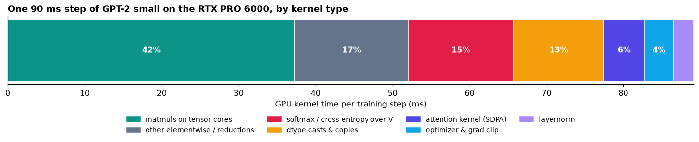

# The training loop, made to tell the truth

**ERA V5 · Session 10.** A real **124M-parameter GPT-2** training loop on an **NVIDIA RTX PRO 6000 Blackwell**, made to
account for itself: every tensor shape, a gradient checked by hand, gradient accumulation broken on purpose, the grad norm
as an early warning, an honest MFU, and the number 0.1 in fp32 / bf16 / fp8.

| | |
|---|---|
| Notebook, executed, all outputs | [`training_loop.ipynb`](training_loop.ipynb) |
| Same notebook as a [marimo](https://marimo.io) file (reactive, with sliders) | [`training_loop.py`](training_loop.py) · run with `marimo edit training_loop.py` |
| Hardware | NVIDIA RTX PRO 6000 Blackwell Server Edition: 188 SMs, 102 GB, SM clock capped at 2,430 MHz, 600 W · PyTorch 2.11, CUDA 13 |
| Model | GPT-2 small: 12 layers, 12 heads, C = 768, T = 1,024, GPT-2 tokenizer (V padded to 50,304), tied embeddings, **124,475,904 parameters** |
| Precision | bf16 autocast; weights, gradients and AdamW state stay fp32; fp32 loss. No loss scaler needed. |
| Data | TinyStories: 51.0M training tokens (the first 200 MB of the V2 train file) and 5.5M validation tokens. Story lengths vary a lot, which §3 needs. |

Every number below is copied from the notebook's executed output. Anything that is an estimate is marked `[estimate]`.

## Results at a glance

| Task | Result |
|---|---|
| 1 · Shapes | **31 tensors** covering the whole step (forward, loss, backward, clip, AdamW state), each with one line saying what its dimensions mean. All 148 parameter tensors get a gradient of their own shape. |
| 2 · Gradient by hand | `backward()` and a central-difference nudge agree to **5×10⁻¹⁰ – 5×10⁻⁹** relative error on 5 weights in float64. Over a 13-point ε grid, the best float32 manages is 9×10⁻⁴; under bf16 autocast, 1×10⁻¹. |
| 3 · Accumulation broken | The broken gradient is **46% off** the one-big-batch gradient (the correct one: 5.8×10⁻⁷). Its dashboard reads **14.6% too low**, yet its held-out loss is **worse: 2.566 vs 2.293**. |
| 4 · Grad norm first | **Step 238**: the norm jumps 1.08 → 2.81 (2.8× its trailing median) while that step's batch loss is ordinary (z = +0.73). The fixed probe loss then rises 3.91 → 4.23 after that update. Over the slow run-up to divergence, a causal detector fires on the grad norm **56 steps before** it fires on the batch loss. |
| 5 · MFU | **33.3%** (156 TFLOP/s of 468). The best variant I timed (`torch.compile`, B = 32) reaches 36.4%. 15 ms per step stand between me and 40%. More than half the step is not matmuls, and keeping the loss over 50,304 words in fp32 alone costs 7.3 ms. |
| 6 · 0.1 | fp32 `0x3DCCCCCD`, bf16 `0x3DCD`, E4M3 `0x1D`, all three checked against PyTorch. **I'd train in bf16 mixed precision with fp32 weights and optimizer state**; fp8 runs at 2× the speed here (804 vs 411 TFLOP/s) but needs per-tensor scaling. |

---

## 1 · Every tensor shape in the step

B = 16 sequences, T = 1,024 positions, C = 768 channels, 12 heads of 64, V = 50,304. The table is produced by the real
forward pass of the exact training step (a `note()` hook inside the model records each tensor), not typed by hand.
Gradient shapes are read after `backward()`, AdamW state after `step()`.

| tensor | shape | dtype | what each dimension means |
|---|---|---|---|
| `idx` | (16, 1024) | int64 | B, T: token ids, B sequences of T positions |
| `wte(idx)` | (16, 1024, 768) | float32 | B, T, C: one C-wide vector per token |
| `wpe(arange(T))` | (1024, 768) | float32 | T, C: one vector per position, broadcast over B |
| `x = tok + pos` | (16, 1024, 768) | float32 | B, T, C: the residual stream |
| `qkv = c_attn(ln1(x))` | (16, 1024, 2304) | bfloat16 | B, T, 3C: q, k and v for every position, side by side |
| `q` (k, v identical) | (16, 12, 1024, 64) | bfloat16 | B, heads, T, head_dim: each head works on its own 64-wide slice of C |
| scores `q·kᵀ/√d` (virtual) | (16, 12, 1024, 1024) | bfloat16 | B, heads, T_query, T_key: fused inside flash attention, never stored |
| `softmax(scores)·v` | (16, 12, 1024, 64) | bfloat16 | B, heads, T, head_dim: a weighted mix of earlier v |
| heads merged | (16, 1024, 768) | bfloat16 | B, T, C: heads concatenated back into the channel axis |
| `x + attn_proj(y)` | (16, 1024, 768) | float32 | B, T, C: residual stream after attention |
| `fc(ln2(x))` | (16, 1024, 3072) | bfloat16 | B, T, 4C: the MLP widens every position 4× |
| `x + mlp_proj(gelu(h))` | (16, 1024, 768) | float32 | B, T, C: residual stream leaving the block |
| after all 12 blocks | (16, 1024, 768) | float32 | B, T, C: blocks 1–11 repeat block 0 exactly |
| `ln_f(x)` | (16, 1024, 768) | float32 | B, T, C: normalised before the head |
| `logits = head(x)` | (16, 1024, 50304) | bfloat16 | B, T, V: a score for every vocabulary entry at every position |
| `logits.float()` | (16, 1024, 50304) | float32 | B, T, V: the same scores upcast for a stable loss; 824M × 4 B = 3.3 GB |
| `y` (targets) | (16, 1024) | int64 | B, T: x shifted left by one, the token each position must predict |
| `logits.view(-1, V)` | (16384, 50304) | float32 | B·T, V: every position becomes one 50,304-way classification |
| `loss` | () | float32 | one scalar, the mean over all 16,384 predictions |
| `logits.grad` | (16, 1024, 50304) | bfloat16 | B, T, V: `(softmax − one_hot)/(B·T)`, the first gradient `backward()` hands back to the model |
| `wte.weight.grad` | (50304, 768) | float32 | V, C: always the weight's own shape; tied, so it sums the head and embedding paths |
| `wpe.weight.grad` | (1024, 768) | float32 | T, C: one gradient row per position |
| `blocks[0].c_attn.weight.grad` | (2304, 768) | float32 | 3C, C: `nn.Linear` stores (out_features, in_features) |
| `blocks[0].c_attn.bias.grad` | (2304,) | float32 | 3C: one bias per q, k, v channel |
| `blocks[0].fc.weight.grad` | (3072, 768) | float32 | 4C, C: the MLP up-projection |
| `blocks[0].mlp_proj.weight.grad` | (768, 3072) | float32 | C, 4C: the MLP down-projection |
| `ln_f.weight.grad` | (768,) | float32 | C: one gain per channel |
| grad norm | () | float32 | one number summarising all 124M gradients, logged every step |
| AdamW `step` (wte) | () | float32 | how many updates this weight has had |
| AdamW `exp_avg` (wte) | (50304, 768) | float32 | V, C: running mean of the gradient, per weight |
| AdamW `exp_avg_sq` (wte) | (50304, 768) | float32 | V, C: running mean of the squared gradient, per weight |

Two checks, because a right shape can still hold wrong numbers. Every row of `logits.grad` sums to zero (largest |row sum|
1.0×10⁻⁸), and it matches `(softmax − one_hot)/(B·T)` to 1.6×10⁻⁴ of its largest entry, which is bf16 storage, not a bug.
Parameters: 38.6M in the tied embedding, 0.79M for positions, 7.09M per block, **124,475,904 total**. Untied, the head
would add another 38.6M.

## 2 · One gradient, verified by hand

Nudge a weight both ways and ask the loss: $\frac{\partial L}{\partial w} \approx \frac{L(w+\varepsilon) - L(w-\varepsilon)}{2\varepsilon}$.
First the lecture's toy chain (`backward()` 64.00000000, nudge 64.00000001). Then the real model, in **float64** with
ε = 10⁻⁵, on one fixed batch:

| weight | index | `backward()` and nudge agree to (relative error) |
|---|---|---|
| `blocks[0].fc.weight` (largest gradient) | (226, 172) | 5.1×10⁻⁹ |
| `blocks[11].attn_proj.weight` (largest gradient) | (117, 126) | 4.0×10⁻⁹ |
| `ln_f.weight` (largest gradient) | (160,) | 7.0×10⁻¹⁰ |
| `wpe.weight` (position 3) | (3, 7) | 3.7×10⁻⁹ |
| `wte.weight` (token `' ball'`, tied) | (2613, 11) | 4.7×10⁻¹⁰ |

**8–9 significant digits on every weight.** The tied `wte` entry is the interesting one: its gradient is the sum of the
embedding path and the output-head path, and the nudge, which only asks the loss, agrees with that sum.

**Where it stops agreeing** ([plot](results/r1-nudge-precision.png)). Repeated in float32 and under bf16 autocast over ε from
10⁻¹ to 10⁻⁷: the best is **9×10⁻⁴ in float32** (ε = 3×10⁻²) and only **1×10⁻¹ under bf16** (ε = 10⁻¹). Small ε fails because
a loss of ~11 stored in float32 is only known to ~10⁻⁶, so the nudge vanishes into rounding. Large ε fails from truncation.
That is why gradient checks are done in float64.

**Gradients add, they don't replace:** two `backward()` calls without `zero_grad()` give exactly 2.000000× the gradient.
That is the mechanism accumulation relies on, and the bug you get when you forget to clear them.

## 3 · Gradient accumulation, broken on purpose

**Setup.** Each optimiser step is built from 4 micro-batches of 16 stories, each read from its first token and cut at **T = 16, 32, 128 and 256**, padded,
with padding masked out of the loss. So they hold very different numbers of real tokens: **256, 512, 2,040 and 3,068**.

- **correct:** `loss_i.sum() / N_total` per micro-batch, so every real token in the step has the same weight.
- **broken:** `loss_i.mean() / 4`, the average of averages. A token in the T = 16 micro-batch then counts **12× as much** as a
  token in the T = 256 one, and 5.7× what it should.

On one fixed step in float32, the correct version matches the one-big-batch gradient to **5.8×10⁻⁷**. The broken one is
**46% off** (cosine 0.924, 1.19× too long). Then both were trained for 1,000 steps from the same weights, on the same
micro-batches in the same order:

| after 1,000 steps | correct | broken |
|---|---|---|
| true per-token train loss (mean of last 50 steps) | **2.041** | 2.260 (+0.218) |
| what the broken run's dashboard reports vs the truth, last 100 steps | 0% | **−14.6%** (every one of the 1,000 steps between −22.5% and −0.2%) |
| held-out loss, positions ≥ 16 | **2.293** | 2.566 (+0.273) |
| held-out loss, positions < 16 | 1.238 | 1.252 (+0.014) |

**What it shows.**
- **The sign surprised me.** The lecture's example overstated the loss by 15.4%. Here the broken dashboard *understates* it by
  14.6%. The T = 16 micro-batch holds only story openings ("Once upon a time…"), which are easy to predict, and the average
  of averages over-weights them. So the broken run *looks* better on its own chart (panel A) while it is worse. Which way the
  error goes depends on which micro-batches are easy, so the curve alone cannot tell you.
- **The damage is real.** On the long-context loss the broken run ends 0.27 nats behind, a level the correct run had already
  reached by step 650 of 1,000. On the diagnostic step the uneven weights are worth only ~2,400 equally weighted tokens out
  of 5,876 (Kish effective sample size), so most of each step's data is barely used.
- **Fix:** count the real tokens across the whole step once, before the first `backward()`, and divide every micro-batch's
  summed loss by that one number.

## 4 · The grad norm, every step, and a step where it moved first

**The normal run** is 2,000 steps of 16 × 1,024 tokens (33M tokens), peak LR 6e-4 with warmup and cosine decay, clipped at
1.0. The grad norm is logged **before** clipping at every step. Loss falls from 10.96 to 1.597. After warmup the norm is
boring, which is the point: median 0.556, p95 0.790, p99 0.911, max 1.49, and clipping fires on 0.2% of post-warmup steps
([plot](results/r3-main-run.png)). No step passes the spike filter below.

**To make the norm warn of something, the run has to get into trouble.** So a second run ramps the LR exponentially from
1e-4 to 0.3 over 600 steps with **no clipping**. Every step logs the grad norm, the batch loss from that *same* forward pass,
and the loss on a **fixed probe batch** after the update. The probe is a loss that only changes when the weights change, so
an easy or hard batch can't fool it.

**Step 238** (lr ≈ 0.0024):

- The grad norm jumps **1.08 → 2.81**, 2.8× its trailing 20-step median.
- The batch loss from that same forward pass is **3.84**, an ordinary value (z = +0.73). The loss gives no warning.
- The update made from that gradient lifts the probe loss **3.91 → 4.23** (24.7× its normal step-to-step jitter). The next
  update (step 239, norm 5.21) takes it to 4.49; it peaks at 5.60 at step 243, then slowly comes back down.

That is a lead of one update, and the step was chosen after the fact, as the best of the three candidates the filter found.
So I also tested the stronger claim, that the norm warns *many* steps early. The rule is causal (each step only looks back), but
where the scan starts and its settings were chosen after seeing this run, so this is one run's evidence (5-step
median vs the median and spread of the previous 50 steps, 3 robust SDs for 5 steps in a row). On the run-up to the final
blow-up (the probe loss passes the untrained model's 9.76 at step 541):

| signal | detector first fires | steps before the blow-up |
|---|---|---|
| batch loss (what a real run sees) | step 525 | 16 |
| **grad norm** | **step 469** | **72** |
| probe loss on a fixed batch | step 345 | 196 |

**The grad norm beat the batch loss by 56 steps.** It did not beat a fixed held-out batch, which rose slowly long before the
gradient got large. The honest summary: the grad norm is a cheap early warning compared with the loss you already log, and
a fixed probe batch every few steps is cheaper still and earlier. No step ever went NaN: AdamW bounds the update size, so the
run just got worse and worse.

## 5 · MFU, measured honestly

$$\text{FLOPs/token} = 6N + 12\,L\,T\,C = 6(123{,}689{,}472) + 12(12)(1024)(768) = 855.4\text{M}\quad(\text{attention adds }15.3\%)$$

**The peak.** NVIDIA's whitepaper gives 503.8 TFLOP/s dense bf16 for the *Workstation* card at 2,617 MHz, which is 1,024 bf16
FLOPs per clock per SM. This is the *Server* card, capped at 2,430 MHz, so its peak is 188 × 1,024 × 2.43 GHz = **468 TFLOP/s**.

| quantity | value |
|---|---|
| median step time (B = 16, T = 1,024, after warmup) | 89.9 ms |
| tokens / s | 182,343 |
| model FLOP/s achieved | 156 TFLOP/s |
| **MFU** (vs 468) | **33.3%** |
| MFU vs the 503.8 whitepaper figure | 31.0% |
| big square bf16 matmul (16,384³), benchmarked alone | 415 TFLOP/s = 89% of peak |
| this model's own matmul shapes, benchmarked alone | 332 TFLOP/s = 71% of peak |
| the same matmuls inside the real training step (profiler) | 326 TFLOP/s = 70% of peak |

Where the GPU time goes (`torch.profiler`, five steps, kernels grouped by what they do):

| kernel group | ms / step | share |
|---|---|---|
| matmuls on tensor cores | 37.3 | 41.8% |
| other elementwise / reductions (GELU, adds, bias, fills) | 14.7 | 16.5% |
| softmax / cross-entropy over V | 13.7 | 15.4% |
| dtype casts & copies | 11.8 | 13.2% |
| attention kernel (SDPA / flash) | 5.3 | 5.9% |
| optimizer & grad clip | 3.8 | 4.2% |
| layernorm | 2.6 | 3.0% |

| variant | ms / step | tokens / s | MFU |
|---|---|---|---|
| eager, B = 16, fp32 loss (the §4 setup, re-timed in the profiler) | 89.8 | 182,515 | 33.4% |
| eager, B = 32, fp32 loss | 180.8 | 181,231 | 33.1% |
| eager, B = 16, bf16 loss | 82.5 | 198,597 | 36.3% |
| `torch.compile`, B = 16, fp32 loss | 83.9 | 195,384 | 35.7% |
| `torch.compile`, B = 32, fp32 loss | 164.5 | 199,213 | 36.4% |

**The distance to 40%:** 40% MFU would be a 74.9 ms step, so I need to find **15.0 ms**. What is costing me, largest first:

1. **More than half the step is not matmuls.** MFU only counts matmul arithmetic, and matmuls fill 42% of GPU time. The
   rest is many small kernels that read a big tensor, do one cheap operation and write it back (GELU, residual and bias adds,
   layernorm, the optimizer). They wait on memory, not arithmetic. `torch.compile` fuses some of them and saves ~6 ms.
2. **The loss over 50,304 words, kept in fp32.** I upcast the logits to fp32 for a numerically safe softmax, which creates a
   3.3 GB tensor written and read several times. Softmax/cross-entropy take 13.7 ms per step and dtype casts another 11.8 ms
   (this upcast, plus autocast re-casting the fp32 weights to bf16 every forward). Keeping the loss in fp32 measurably costs
   **7.3 ms** (the bf16-loss row), about half the 15 ms I need, but bf16 keeps only ~2.4 significant digits, risky in a log-softmax over 50k
   entries. The right fix is a fused or chunked cross-entropy that never builds the full fp32 tensor `[estimate: enough on its
   own to pass 40%]`.
3. **The matmuls run at 70% of peak during training, not 100%.** C = 768 makes every matmul thin. Benchmarked alone, this
   model's matmul shapes reach 71% of peak, against 89% for a big square one. That caps a 124M model on this card regardless of everything else.

**Ruled out, by measurement:** the GPU is busy 99% of the step (so not Python or launch overhead); the SM clock held 2,392 of
2,430 MHz at 405 of 600 W (so no throttling); B = 32 gives the same MFU as B = 16 (the card is already full); flash attention
is 6% of the time and its FLOPs are in the numerator.

**Next:** fused cross-entropy, then `torch.compile`, then fp8 matmuls (2× the bf16 rate on this card, §6). fp8 also doubles
the peak I divide by, so from there tokens per second is the honest number to compare.

## 6 · The number 0.1 in fp32, bf16 and fp8 E4M3

By hand: $0.1 = 1.6 \times 2^{-4}$, and 0.6 in binary is `0.1001 1001 1001 …` repeating forever (double it, keep the integer
part, repeat: 1.2 → **1**, 0.4 → **0**, 0.8 → **0**, 1.6 → **1**, and 0.6 is back). So every format has to cut and round.
The bits after each cut start `11…`, more than half a unit in the last place, so all three round **up**.

| format | layout | sign | exponent | mantissa | hex | stored value | rel. error |
|---|---|---|---|---|---|---|---|
| **fp32** | 1 + 8 + 23, bias 127 | 0 | −4 + 127 = 123 = `01111011` | `10011001100110011001100` → round up → `…1101` | `0x3DCCCCCD` | 0.100000001490116 | 1.5×10⁻⁸ |
| **bf16** | 1 + 8 + 7, bias 127 | 0 | `01111011` (same as fp32) | `1001100` → round up → `1001101` | `0x3DCD` | 1.6015625 × 2⁻⁴ = **0.10009765625** | 9.8×10⁻⁴ |
| **fp8 E4M3** | 1 + 4 + 3, bias 7 | 0 | −4 + 7 = 3 = `0011` | `100` → round up → `101` | `0x1D` | 1.625 × 2⁻⁴ = **0.1015625** | 1.6×10⁻² |

The notebook re-derives each row with exact rational arithmetic (round to nearest, ties to even) and checks the bits against
`struct` and PyTorch's own `bfloat16` / `float8_e4m3fn` casts: all three match. It also has a box where you can type any
number and see its bits in all three formats.

What the difference costs ([plot](results/r6-precision.png)):

- **Range.** A 10⁻⁸ gradient is stored as **0** in fp16 and as 1.001×10⁻⁸ in bf16. fp16 needs a loss scaler; bf16 does not, and
  none of the runs here used one.
- **Precision.** Adding 0.1 ten thousand times gives 999.9 in fp32, **256 in fp16**, **32 in bf16** and **2 in E4M3**. Above 32
  the gap between bf16 numbers is 0.25, so +0.1 rounds away to nothing.
- **Speed.** One 8,192³ matmul on this card: **bf16 411 TFLOP/s** (0.29% error vs fp32), **fp8 E4M3 804 TFLOP/s** (3.8% error,
  with a per-tensor scale).

**Which I'd train in: bf16 mixed precision.** bf16 for matmul inputs and activations; fp32 for master weights, AdamW state and
the loss. bf16 keeps fp32's exponent range, so there is no loss scaler and no gradient a real run produces flushes to zero. Its ~2.4 significant
digits are fine for *computing* a step and fatal for *storing* weights, because a weight update `w − lr·g` is exactly the
"add 0.1 to 32" case, which is why the master copy stays fp32. fp8 really is 2× faster on Blackwell, but with 3 mantissa bits
and a maximum of 448 it needs a scale per tensor (or per block) and wide accumulators behind it. I'd move the matmuls to fp8
only after a side-by-side run against bf16 shows the loss curves overlap.

## Reproduce

The notebook is a marimo notebook: `pip install marimo torch tiktoken matplotlib pandas`, then `marimo edit training_loop.py`
on a CUDA machine. It downloads TinyStories itself. The four long experiments (§3, §4, §5 and the fp8 benchmark) cache their
results in `results/*.pkl`; delete those files to recompute (the §3 pair alone took 157 s on this GPU; a full run is
`[estimate]` 10–20 minutes).
Seeds are fixed, but GPU kernels are not bit-deterministic, so expect the last digits to differ.
